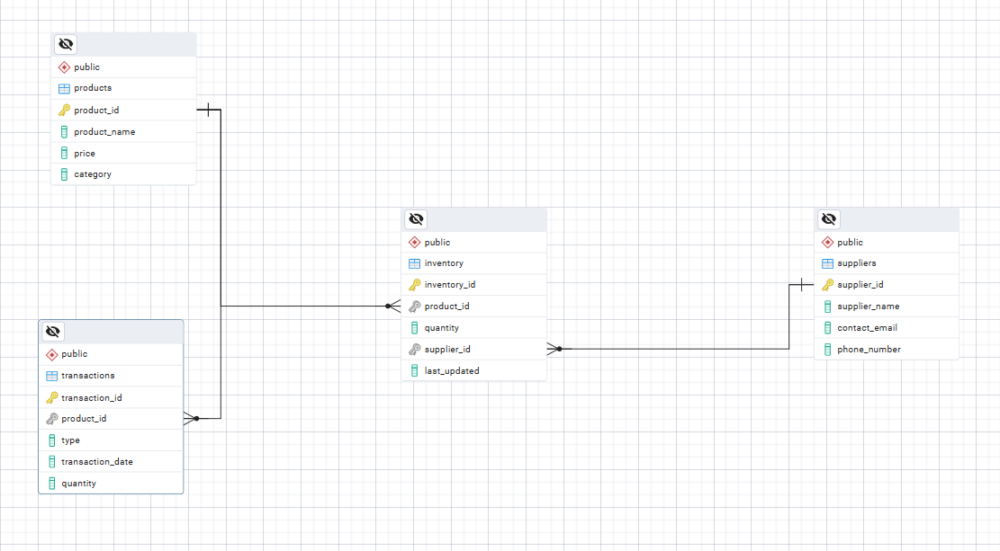

# Inventory Management System

**The question:** a small retailer keeps running out of some items and overstocking others. What's running low, what's selling, and what should be reordered this month?

I designed the database from scratch in PostgreSQL and built in the guardrails I'd want in any system that moves stock or money.



## Design

| Table | Holds | Guardrail |
|---|---|---|
| `products` | Name, price, category | Price can't be negative |
| `suppliers` | Supplier contact details | — |
| `inventory` | Stock on hand and reorder level for each product | Stock can never go below zero; one row per product |
| `transactions` | Every sale and purchase, with a date | Type limited to `sale` or `purchase`; quantity must be positive |

**Stock stays in sync on its own.** A trigger updates `inventory` whenever a transaction is recorded, so nobody updates stock by hand. A sale larger than the stock on hand is rejected, which prevents overselling.

## Questions answered

| # | Question | Result on the sample data |
|---|---|---|
| Q1 | What's in stock right now? | Laptops 7, desk chairs 18, notebooks 250, spoons 1,500 |
| Q2 | What needs reordering, and from whom? | A `reorder_list` view flags 3 of 4 products below their reorder level, with the supplier to call |
| Q3 | What sold best each month, by units and by value? | Laptops lead by value in both May and June, even though spoons and notebooks lead by units |
| Q4 | Does stock on hand match opening stock plus purchases minus sales? | Gap = 0 for every product |
| Q5 | Is overselling blocked? | Yes: a 1,000-unit laptop sale fails the stock check |

**The product lesson:** ranking by units and ranking by value give different answers (Q3). Whichever one a dashboard shows by default decides what the team chases, so pick it on purpose.

## Run it

```bash
createdb inventory
psql -d inventory -f inventory_management_system.sql
```

## Version history

- **v2:** fixed a syntax error that stopped the script from running; replaced hand-written stock updates with a trigger; added reorder levels, a reorder view, a monthly ranking and a reconciliation check; gave the sample data real dates so the monthly report returns results.
- **v1:** schema, sample data and basic reports.
